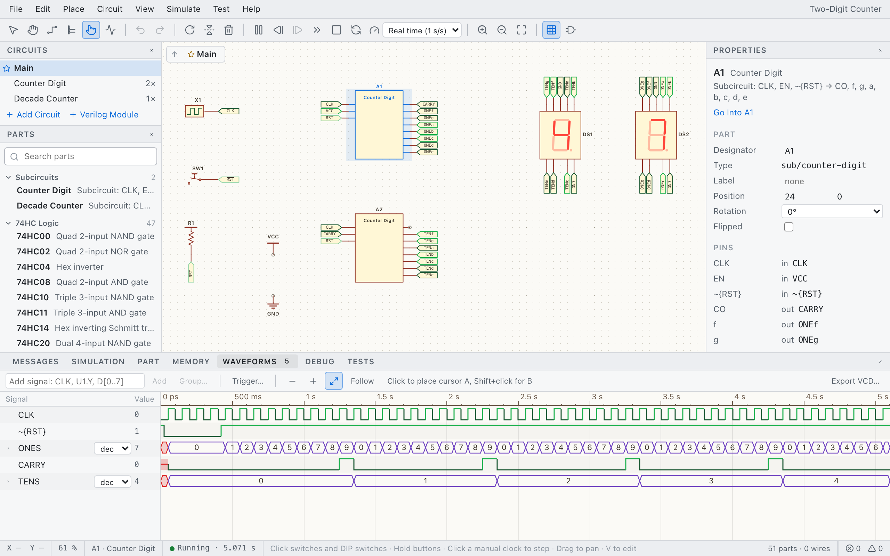

# Saltator

**A digital logic simulator for the browser. Test before fab.**

[Try it in your browser →](https://berrymoreoss.github.io/saltator/)

<picture>
  <source media="(prefers-color-scheme: dark)" srcset="docs/images/screenshot-dark.png">
  
</picture>

Design a circuit from real chips, run it with datasheet propagation delays, watch every wire,
look inside ROM and RAM, and verify it with test benches before you build it on a breadboard.

The goal is to go from a single NAND gate to a complete 8-bit computer with a 16-bit address bus
(think Ben Eater's SAP-1 and 6502 builds, then beyond).

- **Real parts**: 74HC gates, MSI chips, registers and counters, EEPROM and SRAM, the W65C02S,
  character and color TFT displays; more families later (VIA, Z80, AVR, PIC).
- **Faithful simulation**: event-driven, 4-state logic (0/1/X/Z), drive strengths, propagation
  delays, bus contention and floating-input detection.
- **See inside**: live signal colors, LEDs and displays, memory inspector, logic analyzer,
  debugger with rewind.
- **Verify**: test benches and test vectors for your own circuits, in the app and headless.
- **Programmable logic**: modules written in Verilog, synthesized by Yosys, run as parts.

Somewhere between Logisim and Proteus, built for learning and for building real hardware.

Saltator is part of [Berrymore Open Source](https://github.com/berrymoreoss).

## Status

Early development; milestones M1 "Hello, LED" and M2 "Tools" are reached. In: the kernel, a
schematic editor that runs circuits live, files and examples, 74HC logic with datasheet timing
checks, memories, character and TFT displays, buses and subcircuits, the 6502 CPU, Verilog modules,
and the tools to see inside a design and verify it: memory inspector, waveforms, debugger with
rewind, test benches. Next: the SAP-1 (M3) and a 6502 "Hello, World" (M4). See the
[roadmap](docs/roadmap.md).

## Quick start

Requires Node ≥ 24 and pnpm (`corepack enable`).

```sh
pnpm install
pnpm dev        # http://localhost:5173
pnpm check      # typecheck, lint, layer rules, tests
pnpm build      # production build in dist/
```

Circuits are saved as `.saltator.json` files; File ▸ New from Example… opens the bundled ones.

## Documentation

- [Vision](docs/vision.md) — goals, non-goals, principles
- [Roadmap](docs/roadmap.md) — tracks of work, their items, milestones
- [Architecture](docs/architecture.md) — layers and data flow
- [Simulation model](docs/simulation.md) — how the kernel works
- [Components](docs/components.md) — how parts are defined and tested
- [Circuit model](docs/circuit.md) — documents, file format, wiring rules, compiler
- [Decisions](docs/adr/README.md) — architecture decision records

## How this project is developed

AI-first, one feature branch per roadmap item. Items belong to tracks (the parts library, the
SAP-1, the 6502 systems, …) that move in parallel, one branch per track at a time. Each item gets
its own branch and a plan in [`.ai/plans/`](.ai/plans/); agents follow [AGENTS.md](AGENTS.md) and
the workflows in [`.ai/workflows/`](.ai/workflows/). With Claude Code:

1. `/start-branch` — picks a track's next item (`pnpm roadmap` shows them), creates the branch,
   drafts the plan, asks the open questions.
2. Work in sessions: `/handoff` before `/clear` saves the state into the plan, `/resume-branch`
   picks it up in the next session.
3. `/finish-branch` — verifies acceptance criteria, updates docs and roadmap, merges after approval.

## License

[MIT](LICENSE) © 2026 Sergei Aleinik. The examples include third-party sources under their own
licenses: [PicoRV32](examples/verilog/picorv32/README.md) (ISC).
