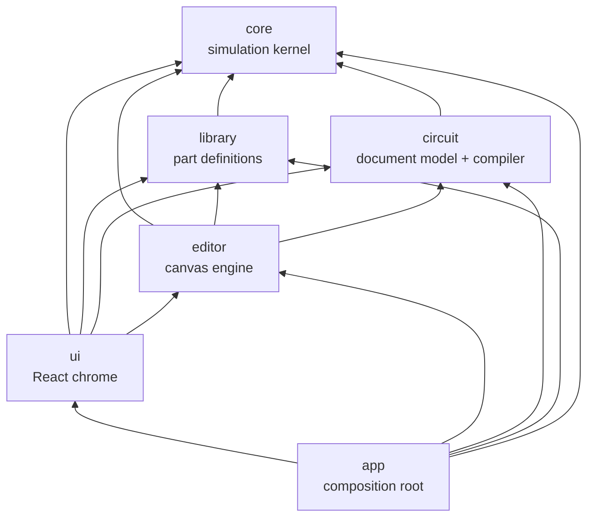

# Architecture

This document is the map of the system. Detailed specs live in
[simulation.md](simulation.md) (kernel) and [components.md](components.md) (parts). Decisions
with alternatives are recorded in [adr/](adr/).

> Status: the foundation (R00) defines the target architecture. Sections marked _(planned)_
> describe intent that the corresponding roadmap item will confirm or refine. Update this file
> when an implementation deviates.

## Stack

Vite + TypeScript (strict) + React for the UI chrome, a custom Canvas2D renderer for the
schematic, Vitest for tests, Biome for lint/format, pnpm. Rationale:
[ADR-0002](adr/0002-tech-stack.md).

## Layers



| Layer   | Path                      | Responsibility                                                                            | May import             | Pure* |
| ------- | ------------------------- | ----------------------------------------------------------------------------------------- | ---------------------- | ----- |
| core    | `src/core`                | Signal model, event queue, net resolution, component runtime API, test bench              | —                      | yes   |
| library | `src/library`             | Part definitions: pins, package, props, timing, symbol geometry, behavior; registry       | core                   | yes   |
| circuit | `src/circuit`             | Circuit document, JSON schema + migrations, connectivity, netlist compiler, design checks | core                   | yes   |
| editor  | `src/editor`              | Canvas2D rendering, camera, hit-testing, tools, commands + undo/redo, live signal overlay | core, library, circuit | no    |
| ui      | `src/ui`                  | React panels: toolbar, palette, inspector, docks (diagnostics, memory, analyzer)          | all but app            | no    |
| app     | `src/app`, `src/main.tsx` | Composition root: registry, simulator host, editor, React tree                            | all                    | no    |

\* **Pure** = no DOM, no React, no Node APIs, no npm packages (unless allowlisted in
`scripts/check-layers.ts` with an ADR). Pure layers must run unchanged in a browser, a Web
Worker and Node.

Enforcement:

- `pnpm check:layers` (`scripts/check-layers.ts`) rejects imports that cross layers the wrong way
  and package imports in pure layers.
- `tsconfig.core.json` type-checks pure layers without the DOM lib, so `window`, `document`,
  `requestAnimationFrame` etc. are compile errors there.

Rationale: [ADR-0005](adr/0005-layered-architecture.md).

## Data flow


1. The **circuit document** is what the user edits and what gets saved.
2. The **compiler** (`circuit`) flattens it into a **netlist**: component instances
   `(id, type, props)` plus nets (sets of `(componentId, pinName)`).
3. The **simulator** (`core`) instantiates behaviors from the **registry** (`library`) and runs
   the netlist.
4. The **editor** reads net levels every frame to color wires and draw indicators. UI panels
   subscribe to change streams (waveforms, memory accesses, diagnostics).
5. User interaction with parts (pressing a button) goes to the simulator as an external event at
   the current simulation time.
6. On edit, the document is recompiled and the simulator rebuilt _(planned: preserving per-instance
   state such as memory contents and flip-flop states, keyed by component id)_.

## Simulation kernel (core)

Event-driven with real time (integer picoseconds), 4-state logic with drive strengths, inertial
delays, delta cycles for zero-delay elements, deterministic ordering. Full spec:
[simulation.md](simulation.md). Rationale: [ADR-0003](adr/0003-event-driven-simulation.md).

Run control (real-time pacing, speed factor, frame budget) is **not** in core: core exposes
`runUntil(time, budget)`, and a _simulator host_ in the app/editor layer drives it from
`requestAnimationFrame`. This keeps core pure and makes moving the kernel into a Web Worker a
host-only change _(planned, backlog)_.

## Component library

Each part is a definition object: identity, pins (with physical numbers), package, properties,
timing with datasheet source, optional unit (gate section) grouping, symbol geometry as data, and
a behavior factory. 74xx chips are modeled as **packages** (DIP with real pinout); power pins exist
but are not simulated in the MVP. Spec: [components.md](components.md). Rationale:
[ADR-0004](adr/0004-chips-as-packages.md).

Bigger parts (ROM/RAM, CPUs, microcontrollers, peripherals) are ordinary components with internal
state; they additionally expose an **inspection interface** (memory view, CPU registers) for UI
panels and a **debug access** path (flash a ROM, poke RAM) that bypasses simulated timing
_(planned, R12/R17)_.

## Circuit model

_(planned, R02 — this section is the starting proposal)_

- **Document**: `{ schemaVersion, circuits: [...] }`; a circuit has component instances
  `{ id, type, x, y, rotation, flip, props, label }` and wires as orthogonal polylines in grid
  coordinates. Later: net labels/tunnels, buses, subcircuit instances.
- **Connectivity is geometric** (as in Logisim): a wire endpoint connects to any pin or wire
  endpoint at the same grid point, and to a wire segment it lands on (T-junction, drawn with a
  dot). Crossing wires do not connect. Union-find over grid points produces nets.
- **IDs are stable** (`nanoid`-style strings generated by the editor) so simulator state, undo
  history and selections survive recompilation.
- **Schema versioning**: every saved document carries `schemaVersion`; loaders run migrations
  forward. Never break old files silently.
- **Design checks** (pre-simulation): unconnected inputs, outputs shorted together, unknown parts,
  later power-pin checks.

## Editor

_(planned, R04/R05)_ Framework-agnostic TypeScript on top of a `<canvas>`:

- **Renderer**: Canvas2D, HiDPI-aware, redraws on demand (dirty flag + `requestAnimationFrame`),
  layered (grid → wires → parts → overlays). Wire colors reflect net level (e.g. 1 = bright
  green, 0 = dark green, Z = blue, X = red; contention flashes).
- **Camera**: pan/zoom with world ↔ screen transforms; world unit = grid cell.
- **Tools**: select/move, place part, draw wire (orthogonal, L-shaped auto-route), pan, delete,
  rotate, duplicate, copy/paste.
- **Commands**: every document mutation is a command with `do/undo`; the history drives undo/redo.
- **Interaction with running simulation**: clicking an interactive part (button, switch) sends an
  external event; LEDs and displays render from net levels.
- **Symbol drawing**: DIP packages are drawn generically from the package definition; other parts
  have renderer functions keyed by symbol kind. The library supplies geometry data only.

## UI

_(planned, R04+)_ React application shell:

```
┌───────────────────────── toolbar: run · pause · step · reset · speed · file ─────────────────────────┐
│ palette  │                                canvas                                    │ inspector     │
│ (search, │                                                                          │ (props of     │
│ library) │                                                                          │ selection)    │
├──────────┴──────────────── bottom dock: diagnostics · memory · logic analyzer ───────┴───────────────┤
```

State that lives outside React (document, simulator, editor) is exposed through small observable
stores and consumed with `useSyncExternalStore`. React never owns simulation state.

## Persistence

_(planned, R07)_ Save/load the document as a `.logic.json` file (File System Access API with
download/upload fallback), autosave to IndexedDB, built-in example gallery. ROM images import and
export as `.bin` and Intel HEX _(R12)_.

## Testing strategy

- **Kernel**: unit tests for every module plus scenario tests (ring oscillator period, inertial
  pulse filtering, latch behavior, contention, floating inputs, determinism).
- **Parts**: every part has a test generated from its datasheet function table plus at least one
  timing assertion, using the core test bench.
- **Circuits**: example projects ship with test benches (R15) that run headless in CI.
- **Editor/UI**: unit tests for pure logic (geometry, commands, routing); browser e2e tests
  (Playwright) are introduced with the editor _(R04)_.
- **Performance**: Vitest benchmarks for the kernel; results recorded in the plan that changed them.

## Extensibility

New part families are added as library modules without touching the kernel: CPUs (6502, Z80),
microcontrollers (AVR via an instruction-level core driving pins, PIC), memories, peripherals.
Anything that can be expressed as "react to pin changes, drive pins after a delay, keep internal
state, optionally schedule timers" fits the component API.
