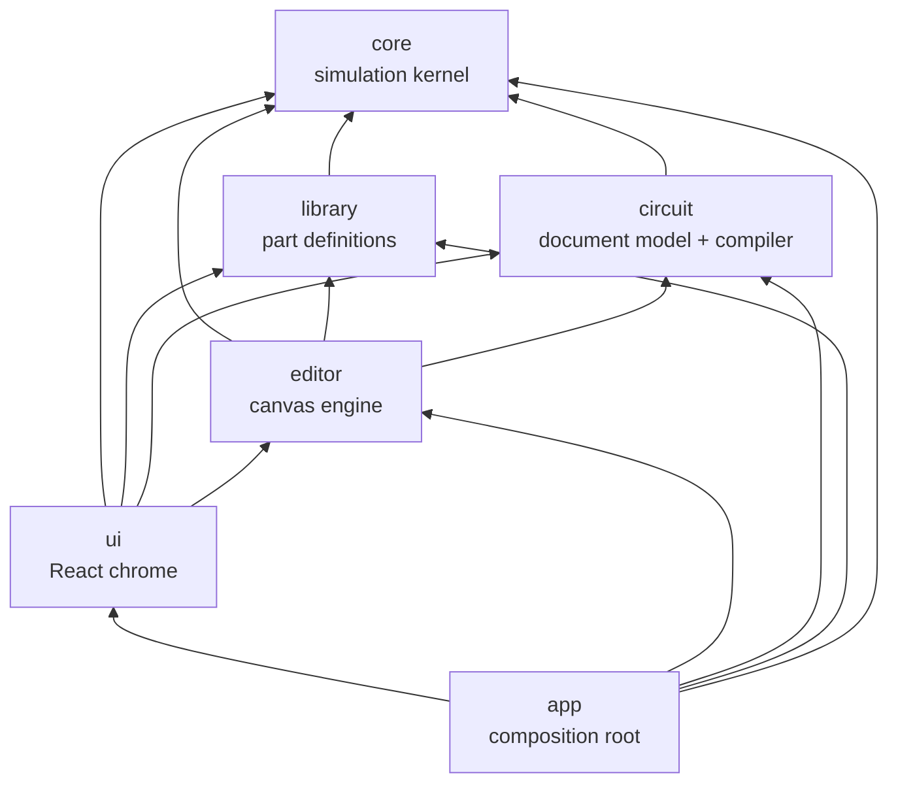

# Architecture

This document is the map of the system. Detailed specs live in
[simulation.md](simulation.md) (kernel) and [components.md](components.md) (parts). Decisions
with alternatives are recorded in [adr/](adr/).

> Status: the foundation (R00) defines the target architecture. Sections marked _(planned)_
> describe intent that the corresponding roadmap item will confirm or refine. Update this file
> when an implementation deviates.

## Stack

Vite + TypeScript (strict) + React for the UI chrome, a custom Canvas2D renderer for the
schematic, Vitest for tests, Biome for lint/format, pnpm. Rationale:
[ADR-0002](adr/0002-tech-stack.md).

## Layers



| Layer   | Path                      | Responsibility                                                                            | May import             | Pure* |
| ------- | ------------------------- | ----------------------------------------------------------------------------------------- | ---------------------- | ----- |
| core    | `src/core`                | Signal model, event queue, net resolution, component runtime API, test bench              | —                      | yes   |
| library | `src/library`             | Part definitions: pins, package, props, timing, symbol geometry, behavior; registry       | core                   | yes   |
| circuit | `src/circuit`             | Circuit document, JSON schema + migrations, connectivity, netlist compiler, design checks | core                   | yes   |
| editor  | `src/editor`              | Canvas2D rendering, camera, hit-testing, tools, commands + undo/redo, live signal overlay | core, library, circuit | no    |
| ui      | `src/ui`                  | React panels: toolbar, palette, inspector, docks (diagnostics, memory, analyzer)          | all but app            | no    |
| app     | `src/app`, `src/main.tsx` | Composition root: registry, simulator host, editor, React tree                            | all                    | no    |

\* **Pure** = no DOM, no React, no Node APIs, no npm packages (unless allowlisted in
`scripts/check-layers.ts` with an ADR). Pure layers must run unchanged in a browser, a Web
Worker and Node.

Enforcement:

- `pnpm check:layers` (`scripts/check-layers.ts`) rejects imports that cross layers the wrong way
  and package imports in pure layers.
- `tsconfig.core.json` type-checks pure layers without the DOM lib, so `window`, `document`,
  `requestAnimationFrame` etc. are compile errors there.

Rationale: [ADR-0005](adr/0005-layered-architecture.md).

## Data flow


1. The **circuit document** is what the user edits and what gets saved.
2. The **compiler** (`circuit`) flattens it into a **netlist**: component instances
   `(id, type, props)` plus nets (sets of `(componentId, pinName)`).
3. The **simulator** (`core`) instantiates behaviors from the **registry** (`library`) and runs
   the netlist.
4. The **editor** reads net levels every frame to color wires and draw indicators. UI panels
   subscribe to change streams (waveforms, memory accesses, diagnostics).
5. User interaction with parts (pressing a button) goes to the simulator as an external event at
   the current simulation time.
6. On edit, the document is recompiled. A running simulation goes on: an edit that keeps the
   structure keeps the simulator; any other continues in the new netlist with every unchanged
   part's state, drives, pending changes and timers carried over by component id, through the
   edit's renames (`Simulator.carryOver`, [ADR-0010](adr/0010-running-simulations.md)).

## Simulation kernel (core)

Event-driven with real time (integer picoseconds), 4-state logic with drive strengths, inertial
delays, delta cycles for zero-delay elements, deterministic ordering. Full spec:
[simulation.md](simulation.md). Rationale: [ADR-0003](adr/0003-event-driven-simulation.md).

Run control (real-time pacing, speed factor, frame budget) is **not** in core: core exposes
`runUntil(time, budget)`, and the _simulator host_ in the editor layer (`Simulation`, R05)
drives it from `requestAnimationFrame` with an injected clock. This keeps core pure and makes
moving the kernel into a Web Worker a host-only change _(planned, backlog)_.

## Component library

Each part is a definition object: identity, pins (with physical numbers), package, properties,
timing with datasheet source, optional unit (gate section) grouping, symbol geometry as data, and
a behavior factory. 74xx chips and timers are modeled as **packages** (DIP with real pinout); power
pins exist but are not simulated in the MVP. Analog timing networks are props
([ADR-0013](adr/0013-behavioral-timer.md)). Spec: [components.md](components.md). Rationale:
[ADR-0004](adr/0004-chips-as-packages.md).

Real chips (R06: 74HC gates and bus buffers) come from the Nexperia data sheets: a chip's
function (`ChipSpec`: pinout with pin descriptions, units, function table, behavior) is shared by
every logic family, which supplies the data sheet and timing (`LogicFamily`, HC at 4.5 V /
50 pF). The function table on the definition is shown in the Part tab and checked by the part's
tests ([ADR-0011](adr/0011-real-chips.md)).

Bigger parts (ROM/RAM, CPUs, microcontrollers, peripherals) are ordinary components with internal
state; they additionally expose an **inspection interface** (memory view, CPU registers) for UI
panels and a **debug access** path (flash a ROM, poke RAM) that bypasses simulated timing
_(planned, R12/R17)_.

## Circuit model

Implemented in R02. Full spec: [circuit.md](circuit.md). Rationale:
[ADR-0006](adr/0006-circuit-document-and-connectivity.md).

- **Document**: `{ schemaVersion, circuits: [...] }`; a circuit has component instances
  `{ id, type, x, y, rotation, flip, props, label? }` and wires, each one straight horizontal or
  vertical segment `{ id, from, to }` in integer grid coordinates. Immutable values in memory.
  Later: net labels/tunnels, buses (R10), subcircuit instances (R11).
- **A component's id is its designator** (`U1`, `SW1`): readable in netlists, diagnostics and
  test benches. `label` is free display text.
- **Pin positions are derived** from part definitions (`partLayout`: DIP drawing for packages,
  the part's `symbol` otherwise, a generic box as a fallback), shared by the compiler and the
  editor.
- **Connectivity is geometric; everything that touches connects** (as in Logisim): wire ends and
  pins connect to wire ends, wire interiors (T-junctions) and pins at the same point; crossing
  wire interiors do not. Junction dots are derived. Union-find over grid points produces nets.
- **Schema versioning**: every saved document carries `schemaVersion`; loading migrates older
  versions forward and rejects newer ones. Never break old files silently.
- **Compiler** (`compileCircuit`): document → `Netlist` with deterministic, readable net ids, plus
  the net of every wire and the junction dots for the editor. It never throws on user mistakes.
- **Design checks** (pre-simulation): unknown part types, invalid props, shorted push-pull
  outputs, undriven inputs, dangling wires; later power-pin checks.

## Editor

Implemented in R04a (view, navigation, selection), R04b (editing) and R05 (running the
simulation). Full spec: [editor.md](editor.md). Framework-agnostic TypeScript on a `<canvas>`:

- **Scene** (pure): the circuit's parts with layouts, placements, bounds, pins with nets and
  text, wires, junctions and issues, rebuilt once per document change.
- **Renderer**: Canvas2D, HiDPI-aware, redraws on demand (dirty flag + `requestAnimationFrame`),
  layered (grid → wires → parts → overlays), culled to the view with text level of detail.
  While simulating, wires and junctions take their net's level color (1 bright green, 0 dark
  green, Z blue, X red, weakly pulled levels paler; contention flashes).
- **Camera**: pan/zoom with world ↔ screen transforms; world unit = grid cell; Figma-style or
  KiCad-style wheel.
- **Symbol drawing**: drawers keyed by `symbol.kind` on a small `SymbolGraphics` surface in local
  cells; DIP packages drawn generically; gates in ANSI or IEC style (a view setting). The library
  supplies geometry data only; pin positions come from `circuit`'s `partLayout`, so drawing and
  connectivity always agree.
- **Hit-testing and selection**: parts, pin stubs and wires under a point; click, Shift-click and
  box selection (inside or touching).
- **`Editor` facade**: owns circuit, scene, selection, camera, tool and the simulator host;
  exposes them as small observable stores.
- **Tools and gestures**: select/move, pan, wire (click by click or dragged from a pin, L-shaped
  preview), place (armed from the Parts panel, sticky); rotate, flip, delete, nudge; floating
  copy/paste and duplicate. Moves keep wires connected (rubber-banding); wires are normalized into
  straight runs after every edit ([ADR-0009](adr/0009-editing-model.md)). Gestures take plain
  `PointerInput`s, so they are unit-tested without a browser.
- **Undo/redo**: every document change is one `edit()` that records a snapshot of the circuit and
  selection before and after; renames are recorded for the simulator host.
- **Simulator host** (`Simulation`): stopped until Run; run, pause, step to the next event, stop,
  reset; speed presets and a frame budget; follows every edit ([ADR-0010](adr/0010-running-simulations.md)).
- **Interaction with the running simulation**: the Interact tool sends a part's action (flip a
  switch, hold a button, toggle a DIP switch, step a manual clock); drawers get the part's live
  state, indicators their average brightness from on-time.

## UI

Implemented in R04a ([editor.md](editor.md#shell), [ADR-0008](adr/0008-desktop-workbench.md)):
a desktop CAD-style React shell; R04b made it edit — Parts arms the place tool or drags parts in,
Properties edits the selected part, a context menu and the Edit/Place menus carry the editing
commands, and the clipboard goes through the browser's clipboard events; R05 made it run — a
Simulate menu and toolbar group with a speed select, the simulation in the status bar, a
Simulation tab with runtime diagnostics, live levels in Properties; R06 added the Part tab (pins
with data sheet descriptions and the function table of the part picked last).

```
┌───────────────────────── menu bar · toolbar (tools, zoom, grid, gate style) ─────────────────────────┐
│ Parts    │                                canvas                                    │ Properties    │
│ (search, │                                                                          │ (of the       │
│ preview) │                                                                          │ selection)    │
├──────────┴──── bottom dock: Messages · Simulation · Part (later: memory · logic analyzer) ┴────────────┤
│ status bar: cursor · zoom · selection · simulation · counts · issues                                  │
```

State that lives outside React (document, simulator, editor) is exposed through small observable
stores (`Store`) and consumed with `useSyncExternalStore`. React never owns simulation state.
Every user action is a command in one registry that drives menus, toolbar and shortcuts; view
preferences (theme, gate style, wheel mode, dock layout) are settings kept in `localStorage`,
never in documents.

## Persistence

Documents are `.logic.json` files written by `serializeDocument` (R07,
[ADR-0012](adr/0012-files-and-sessions.md)): opened and saved through the File System Access API
in Chromium (Save writes back through the file's handle) and a file input / download elsewhere,
behind one `FileAccess` interface (`src/ui/files.ts`). A `DocumentController` keeps the document
session (name, file, saved circuit) and asks before replacing unsaved changes. The session —
unsaved changes, file handle and view included — is autosaved to IndexedDB and restored at
start-up, per browser tab (`src/ui/autosave.ts`, `browser-storage.ts`); Open Recent keeps file
handles there too. Example circuits are files in `examples/`. Spec:
[editor.md](editor.md#files). ROM images import and export as `.bin` and Intel HEX _(R12)_.

## Testing strategy

- **Kernel**: unit tests for every module plus scenario tests (ring oscillator period, inertial
  pulse filtering, latch behavior, contention, floating inputs, determinism).
- **Parts**: every part has a test generated from its datasheet function table plus at least one
  timing assertion, using the core test bench.
- **Circuits**: example projects ship with test benches (R15) that run headless in CI.
- **Editor/UI**: unit tests for pure logic (camera, scene, hit-testing, selection, shortcuts,
  settings) and a scenario test drawing every part; browser e2e tests with Playwright
  (`pnpm e2e`, R04a) for the shell and interaction.
- **Performance**: Vitest benchmarks for the kernel; results recorded in the plan that changed them.

## Extensibility

New part families are added as library modules without touching the kernel: CPUs (6502, Z80),
microcontrollers (AVR via an instruction-level core driving pins, PIC), memories, peripherals.
Anything that can be expressed as "react to pin changes, drive pins after a delay, keep internal
state, optionally schedule timers" fits the component API.
