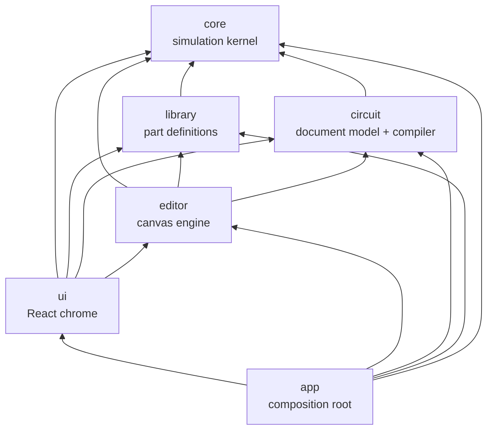
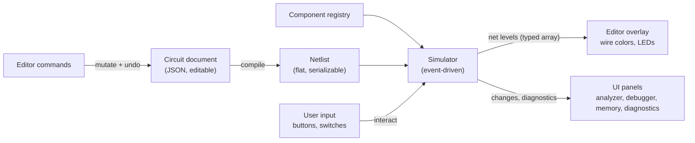
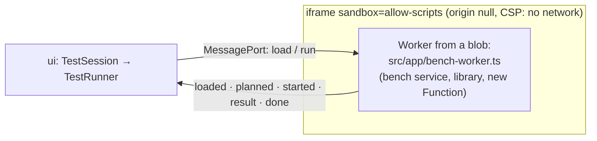

# Architecture

This document is the map of the system. Detailed specs live in
[simulation.md](simulation.md) (kernel) and [components.md](components.md) (parts). Decisions
with alternatives are recorded in [adr/](adr/).

> Status: the foundation (R00) defines the target architecture. Sections marked _(planned)_
> describe intent that the corresponding roadmap item will confirm or refine. Update this file
> when an implementation deviates.

## Stack

Vite + TypeScript (strict) + React for the UI chrome, a custom Canvas2D renderer for the
schematic, Vitest for tests, Biome for lint/format, pnpm. Rationale:
[ADR-0002](adr/0002-tech-stack.md). The UI's packages: `lucide-react` (icons) and CodeMirror 6
for the test script editor (R15b, [ADR-0026](adr/0026-test-bench-sandbox.md)).

## Layers



| Layer   | Path                      | Responsibility                                                                            | May import             | Pure* |
| ------- | ------------------------- | ----------------------------------------------------------------------------------------- | ---------------------- | ----- |
| core    | `src/core`                | Signal model, event queue, net resolution, component runtime API, test bench              | —                      | yes   |
| library | `src/library`             | Part definitions: pins, package, props, timing, symbol geometry, behavior; registry       | core                   | yes   |
| circuit | `src/circuit`             | Circuit document, JSON schema + migrations, connectivity, netlist compiler, design checks | core                   | yes   |
| editor  | `src/editor`              | Canvas2D rendering, camera, hit-testing, tools, commands + undo/redo, live signal overlay | core, library, circuit | no    |
| ui      | `src/ui`                  | React panels: toolbar, palette, inspector, docks (diagnostics, memory, analyzer, debug)   | all but app            | no    |
| app     | `src/app`, `src/main.tsx` | Composition root: registry, simulator host, editor, React tree                            | all                    | no    |

\* **Pure** = no DOM, no React, no Node APIs, no npm packages (unless allowlisted in
`scripts/check-layers.ts` with an ADR). Pure layers must run unchanged in a browser, a Web
Worker and Node.

Enforcement:

- `pnpm check:layers` (`scripts/check-layers.ts`) rejects imports that cross layers the wrong way
  and package imports in pure layers.
- `tsconfig.core.json` type-checks pure layers without the DOM lib, so `window`, `document`,
  `requestAnimationFrame` etc. are compile errors there.

Rationale: [ADR-0005](adr/0005-layered-architecture.md).

## Data flow



1. The **circuit document** is what the user edits and what gets saved.
2. The **compiler** (`circuit`) flattens it into a **netlist**: component instances
   `(id, type, props)` plus nets (sets of `(componentId, pinName)`) — the top circuit with its
   subcircuit instances expanded by path (`A1/U3`, R11a).
3. The **simulator** (`core`) instantiates behaviors from the **registry** and runs the
   netlist: the design's registry — the library's parts and the parts the document's Verilog
   modules run as (HDL-1).
4. The **editor** reads net levels every frame to color wires and draw indicators. UI panels
   subscribe to change streams (memory accesses, diagnostics); the waveform analyzer records
   the probed nets through a core `Recorder` on the kernel's change listener (R13); the
   debugger's breakpoints are repeating core triggers on a recorder of their own, its error
   breaks a diagnostic listener (R14). The host keeps a history of kernel snapshots and the
   user's actions, so a rewind restores the snapshot before an instant and re-runs it in a
   replica the tools don't watch; the tools then catch up by time (R14b).
5. User interaction with parts (pressing a button) goes to the simulator as an external event at
   the current simulation time.
6. On edit, the document is recompiled. A running simulation goes on: an edit that keeps the
   structure keeps the simulator; any other continues in the new netlist with every unchanged
   part's state, drives, pending changes and timers carried over by component id, through the
   edit's renames (`Simulator.carryOver`, [ADR-0010](adr/0010-running-simulations.md)).

## Simulation kernel (core)

Event-driven with real time (integer picoseconds), 4-state logic with drive strengths, inertial
delays, delta cycles for zero-delay elements, deterministic ordering. Full spec:
[simulation.md](simulation.md). Rationale: [ADR-0003](adr/0003-event-driven-simulation.md).

Run control (real-time pacing, speed factor, frame budget) is **not** in core: core exposes
`runUntil(time, budget)`, and the _simulator host_ in the editor layer (`Simulation`, R05)
drives it from `requestAnimationFrame` with an injected clock; a listener can break a run at an
instant (`requestBreak`, R13), which the host turns into a pause, and a run can stop right
before a net's pending change (`stopBefore`, R14: the debugger's Step Clock); the host runs
steps (`runTo`) and pauses on requests with a reason (`requestPause`). Core can snapshot and
restore a whole simulation and replay it in a replica (R14b); the history of checkpoints and
user actions and the rewinds built on it are the host's (`Timeline`,
[ADR-0021](adr/0021-rewind.md)); R11a the Circuits list above Parts, the Circuit menu, the Parts
panel's Subcircuits and Properties of a circuit ([editor.md](editor.md#shell),
[ADR-0023](adr/0023-subcircuits.md)); R11b the breadcrumb bar over the canvas
([ADR-0024](adr/0024-instance-navigation.md)). This keeps core pure and makes
moving the kernel into a Web Worker a host-only change _(planned, backlog)_.

## Component library

Each part is a definition object: identity, pins (with physical numbers), package, properties,
timing with datasheet source, optional unit (gate section) grouping, symbol geometry as data, and
a behavior factory. 74xx chips and timers are modeled as **packages** (DIP with real pinout); power
pins exist but are not simulated in the MVP. Analog timing networks are props
([ADR-0013](adr/0013-behavioral-timer.md)). Spec: [components.md](components.md). Rationale:
[ADR-0004](adr/0004-chips-as-packages.md).

Real chips (R06: 74HC gates and bus buffers) come from the Nexperia data sheets: a chip's
function (`ChipSpec`: pinout with pin descriptions, units, function table, behavior) is shared by
every logic family, which supplies the data sheet and timing (`LogicFamily`, HC at 4.5 V /
50 pF). The function table on the definition is shown in the Part tab and checked by the part's
tests ([ADR-0011](adr/0011-real-chips.md)).

Bigger parts (ROM/RAM, CPUs, microcontrollers, peripherals) are ordinary components with internal
state; they additionally expose an **inspection interface** (memory view, CPU registers) for UI
panels and a **debug access** path (flash a ROM, poke RAM) that bypasses simulated timing: memories
have them since R12a (`ComponentDefinition.memory`, the `poke` action; a ROM's contents are an
`image` prop), CPUs since R17a (`ComponentDefinition.cpu`, registers and the instruction under
way). Memories simulate with their data sheets' limits and show
`X` until their access time ([ADR-0017](adr/0017-memories.md)); they stamp when each cell was
last read and written, which the Memory tab lights up (R12b,
[ADR-0018](adr/0018-memory-inspector.md)). The first peripheral, the HD44780 character LCD,
models its controller at instruction level with a pure state machine beside the bus code, works
out uncertain transfers by running every outcome and merging them, and gives the editor a pure
frame of its glass to draw ([ADR-0022](adr/0022-character-lcd.md)); the ST7789 TFT (LIB-2)
keeps its frame memory as the only picture, which the editor draws as an image, and shows an
uncertain effect as its likely outcome under a veil ([ADR-0031](adr/0031-tft-modules.md)). The first CPU, the
W65C02S (R17a), is a pure cycle-level core — its bus cycles checked against SingleStepTests —
behind a part that puts each cycle on the pins with the data sheet's timing; unknown bits flow
through its registers, and a CPU whose next step depends on them is lost until reset
([ADR-0028](adr/0028-cpu-model.md)). Verilog modules (HDL-1) are parts made at run time: one
interpreter in `src/library/hdl/` runs any module's IR — 4-state bit planes, combinational cells
in topological order inside one `evaluate`, flip-flops on strict edges, one output delay
([components.md](components.md#verilog-modules-hdl), [ADR-0030](adr/0030-hdl-modules.md)).

## Circuit model

Implemented in R02. Full spec: [circuit.md](circuit.md). Rationale:
[ADR-0006](adr/0006-circuit-document-and-connectivity.md).

- **Document**: `{ schemaVersion, circuits: [...] }`; a circuit has component instances
  `{ id, type, x, y, rotation, flip, props, label? }` and wires, each one straight horizontal or
  vertical segment `{ id, from, to, bus? }` in integer grid coordinates (`bus`: a bus line,
  R10b). Immutable values in memory. The first circuit is the top; the others are subcircuits
  (R11a), placed as instances of type `sub/<circuit id>` whose pins are their ports (`net/port`).
- **Subcircuits** (R11a): the compiler flattens the top circuit into one netlist
  (`compileDesign`): every circuit compiled once on its own, inner parts by instance path
  (`A1/U3`), nets joined through ports and bus ports, net labels local to their circuit and the
  power names global. A document registry serves a generated definition per circuit (pins from
  its ports, a box symbol), so the editor treats an instance like any part. The kernel never sees
  the hierarchy ([ADR-0023](adr/0023-subcircuits.md)). The editor shows the open circuit in one
  instance (`EditorState.path`, R11b): the host maps its one scene to that instance's flat nets
  and parts ([ADR-0024](adr/0024-instance-navigation.md)).
- **A component's id is its designator** (`U1`, `SW1`): readable in netlists, diagnostics and
  test benches. `label` is free display text.
- **Pin positions are derived** from part definitions (`partLayout`: DIP drawing for packages,
  the part's `symbol` otherwise, a generic box as a fallback), shared by the compiler and the
  editor.
- **Connectivity is geometric; everything that touches connects** (as in Logisim): wire ends and
  pins connect to wire ends, wire interiors (T-junctions) and pins at the same point; crossing
  wire interiors do not. Junction dots are derived. Union-find over grid points produces nets.
- **Net labels** (R10a) are schematic-only parts whose pin joins the circuit-wide net of its
  name (`PinDef.net`); the VCC and GND symbols join `VCC` and `GND` the same way. The compiler
  leaves schematic-only parts out of the netlist and calls a named net by its name
  ([ADR-0015](adr/0015-net-labels.md)).
- **Graphics** (PLT-1) are schematic-only parts without pins (`draw/text`): drawn, edited and
  saved like any part, never compiled; a text's box is estimated from its lines in the pure
  layers ([ADR-0029](adr/0029-schematic-graphics.md)).
- **Verilog modules** (HDL-1): a circuit written in Verilog keeps the IR Compile made of Yosys's
  JSON netlist (`Circuit.verilog`, schema v6) instead of parts and wires; placed like a
  subcircuit (vectors as bus pins), compiled on its own to one part `U1` of type
  `hdl/<circuit id>` with a net per port bit, which the document registry gets from the
  library's `hdlPart` ([circuit.md](circuit.md#verilog-modules),
  [ADR-0030](adr/0030-hdl-modules.md)). The app never runs Yosys.
- **Buses** (R10b) are groups of nets named by their members (`D[0..7]` → `D0`…`D7`), as in
  KiCad: bus lines and bus pins (bus labels, bus entries' bus ends) are a second connectivity
  layer that never touches wires; bus entries join their bit's net by name, so the netlist and
  the kernel don't know buses ([ADR-0016](adr/0016-buses.md)).
- **Schema versioning**: every saved document carries `schemaVersion`; loading migrates older
  versions forward and rejects newer ones. Never break old files silently.
- **Compiler** (`compileCircuit`): document → `Netlist` with deterministic, readable net ids, plus
  the net of every wire and the junction dots for the editor. It never throws on user mistakes.
- **Resolver** (R12b): references (`U5`, `U5.A0`, `CLK`, `D[0..7]`, and inside instances
  `A1/U3.Q0`, R11a) to the compiled design's parts and nets, for the memory inspector, probes
  (R13), watches and breakpoints (R14; memory cells `U5[1F]`) and test benches (R15a)
  ([circuit.md](circuit.md#resolver)).
- **Probes** (R13): the Waveforms tab's signals as resolver references in the circuit
  (`Circuit.probes`, schema v3), never compiled ([ADR-0019](adr/0019-waveforms.md)).
- **Test scripts** (R15a): a circuit's JavaScript benches (`Circuit.testScript`, schema v5),
  never compiled; `CircuitBench` runs the circuit as the top with drivers on its ports
  ([circuit.md](circuit.md#test-benches), [ADR-0025](adr/0025-test-benches.md)).
- **Design checks** (pre-simulation): unknown part types, invalid props, shorted push-pull
  outputs, undriven inputs, dangling wires, nets with several names, lone net labels, bus
  entries that aren't members of their bus; later power-pin checks.

## Editor

Implemented in R04a (view, navigation, selection), R04b (editing) and R05 (running the
simulation). Full spec: [editor.md](editor.md). Framework-agnostic TypeScript on a `<canvas>`:

- **Scene** (pure): the circuit's parts with layouts, placements, bounds, pins with nets and
  text, wires, junctions and issues, rebuilt once per document change.
- **Renderer**: Canvas2D, HiDPI-aware, redraws on demand (dirty flag + `requestAnimationFrame`),
  layered (grid → wires → parts → overlays), culled to the view with text level of detail.
  While simulating, wires and junctions take their net's level color (1 bright green, 0 dark
  green, Z blue, X red, weakly pulled levels paler; contention flashes).
- **Camera**: pan/zoom with world ↔ screen transforms; world unit = grid cell; Figma-style or
  KiCad-style wheel.
- **Symbol drawing**: drawers keyed by `symbol.kind` on a small `SymbolGraphics` surface in local
  cells; DIP packages drawn generically; gates in ANSI or IEC style (a view setting). The library
  supplies geometry data only; pin positions come from `circuit`'s `partLayout`, so drawing and
  connectivity always agree.
- **Hit-testing and selection**: parts, pin stubs and wires under a point; click, Shift-click and
  box selection (inside or touching).
- **`Editor` facade**: owns the document, the circuit open and its scene, the flattened design,
  selection, camera (one per circuit), tool and the simulator host; exposes them as small
  observable stores. Edits go to the open circuit; one undo history spans the document (R11a).
- **Tools and gestures**: select/move, pan, wire (click by click or dragged from a pin, L-shaped
  preview), place (armed from the Parts panel, sticky); rotate, flip, delete, nudge; floating
  copy/paste and duplicate. Moves keep wires connected (rubber-banding); wires are normalized into
  straight runs after every edit ([ADR-0009](adr/0009-editing-model.md)). Gestures take plain
  `PointerInput`s, so they are unit-tested without a browser.
- **Undo/redo**: every document change is one `edit()` that records a snapshot of the circuit and
  selection before and after; renames are recorded for the simulator host.
- **Simulator host** (`Simulation`): stopped until Run; run, pause, step to the next event, stop,
  reset; speed presets and a frame budget; follows every edit ([ADR-0010](adr/0010-running-simulations.md)).
- **Interaction with the running simulation**: the Interact tool sends a part's action (flip a
  switch, hold a button, toggle a DIP switch, step a manual clock); drawers get the part's live
  state, indicators their average brightness from on-time.

## UI

Implemented in R04a ([editor.md](editor.md#shell), [ADR-0008](adr/0008-desktop-workbench.md)):
a desktop CAD-style React shell; R04b made it edit — Parts arms the place tool or drags parts in,
Properties edits the selected part, a context menu and the Edit/Place menus carry the editing
commands, and the clipboard goes through the browser's clipboard events; R05 made it run — a
Simulate menu and toolbar group with a speed select, the simulation in the status bar, a
Simulation tab with runtime diagnostics, live levels in Properties; R06 added the Part tab (pins
with data sheet descriptions and the function table of the part picked last), R09a its timing
(delays and the minima the timing checks use); R12b the Memory tab (a live hex view of a
memory with reads and writes lit, edits, `.bin` and Intel HEX through a programmer-style Load
dialog, [editor.md](editor.md#memory-inspector)); R13 the Waveforms tab (the probes over
simulated time with zoom, cursors, bus values, a trigger and VCD export) and the Probe tool
([editor.md](editor.md#waveforms), [ADR-0019](adr/0019-waveforms.md)); R14 the Debug tab
(Step Clock, Run For, Run To, breakpoints, breaks on errors, watches; the setup kept with the
session) and run statistics ([editor.md](editor.md#debugger),
[ADR-0020](adr/0020-debugger.md)); R14b stepping back — Step Back, Step Back Clock, Reverse
Continue, the waveforms' ruler, the status behind the present ([editor.md](editor.md#rewinding),
[ADR-0021](adr/0021-rewind.md)); R15b the Tests tab — a circuit's test script in a CodeMirror
editor, its benches run in a sandbox with their failures a click from their lines
([editor.md](editor.md#tests), [ADR-0026](adr/0026-test-bench-sandbox.md)).

```
┌───────────────────────── menu bar · toolbar (tools, zoom, grid, gate style) ─────────────────────────┐
│ Parts    │                                canvas                                    │ Properties    │
│ (search, │                                                                          │ (of the       │
│ preview) │                                                                          │ selection)    │
├──────────┴─ bottom dock: Messages · Simulation · Part · Memory · Waveforms · Debug · Tests ┴─────────┤
│ status bar: cursor · zoom · selection · simulation · counts · issues                                  │
```

State that lives outside React (document, simulator, editor) is exposed through small observable
stores (`Store`) and consumed with `useSyncExternalStore`. React never owns simulation state.
Every user action is a command in one registry that drives menus, toolbar and shortcuts; view
preferences (theme, gate style, wheel mode, dock layout) are settings kept in `localStorage`,
never in documents.

### Test runner

A document's test script is someone's code, so the app runs it only in a **sandbox** (R15b,
[ADR-0026](adr/0026-test-bench-sandbox.md)):



- `circuit`'s **bench service** is the protocol, pure; `src/app/bench-worker.ts` serves it on a
  port inside the worker (and finds a syntax error's line in a nested worker).
- The worker can load nothing from the app's origin, so the runner is **one script**:
  `scripts/vite-bench-runner.ts`, a Vite plugin, bundles `src/app/bench-worker-main.ts` with
  Vite's `build` into an IIFE and serves its text as `virtual:bench-runner` — in `vite dev`,
  `vite build` (a lazy chunk) and vitest alike.
- `ui`'s **`TestRunner`** starts the sandbox (`iframeSandbox`), queues requests, keeps the time
  limits and restarts it after a limit or Cancel (removing the iframe ends the worker); the app
  makes two (listing scripts while typing; runs).

## Persistence

Documents are `.logic.json` files written by `serializeDocument` (R07,
[ADR-0012](adr/0012-files-and-sessions.md)): opened and saved through the File System Access API
in Chromium (Save writes back through the file's handle) and a file input / download elsewhere,
behind one `FileAccess` interface (`src/ui/files.ts`). A `DocumentController` keeps the document
session (name, file, saved circuit) and asks before replacing unsaved changes. The session —
unsaved changes, file handle and view included — is autosaved to IndexedDB and restored at
start-up, per browser tab (`src/ui/autosave.ts`, `browser-storage.ts`); Open Recent keeps file
handles there too. Example circuits are files in `examples/`. Spec:
[editor.md](editor.md#files). ROM contents are saved in the document as `image` props (sparse hex
runs, R12a); they load and save as `.bin` and Intel HEX in the Memory tab (R12b,
`src/core/image-files.ts`, files through `ImageFileAccess`).

## Testing strategy

- **Kernel**: unit tests for every module plus scenario tests (ring oscillator period, inertial
  pulse filtering, latch behavior, contention, floating inputs, determinism).
- **Parts**: every part has a test generated from its datasheet function table plus at least one
  timing assertion, using the core test bench.
- **Circuits**: a circuit's test script (`Circuit.testScript`, R15a) registers benches that run
  it as the top — through its ports or switches, in fixed steps, checks soft, simulation errors
  failing — on a pure runner in `circuit`; the script's text becomes code only in a script host
  (a `node:vm` context in Node, the app's sandbox in the browser). Every example bench runs in
  `pnpm check`, and `pnpm test:circuits` runs any document's in CI
  ([circuit.md](circuit.md#test-benches), [ADR-0025](adr/0025-test-benches.md)); the Tests tab
  runs them in the app (R15b, `tests.spec.ts`).
- **Editor/UI**: unit tests for pure logic (camera, scene, hit-testing, selection, shortcuts,
  settings) and a scenario test drawing every part; browser e2e tests with Playwright
  (`pnpm e2e`, R04a) for the shell and interaction.
- **Performance**: Vitest benchmarks for the kernel; results recorded in the plan that changed them.

## Extensibility

New part families are added as library modules without touching the kernel: CPUs (6502, Z80),
microcontrollers (AVR via an instruction-level core driving pins, PIC), memories, peripherals.
Anything that can be expressed as "react to pin changes, drive pins after a delay, keep internal
state, optionally schedule timers" fits the component API.
